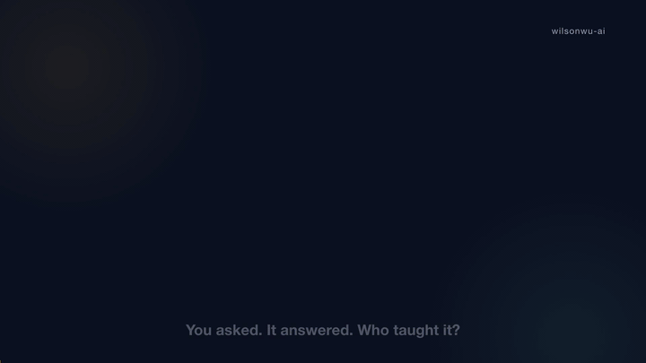
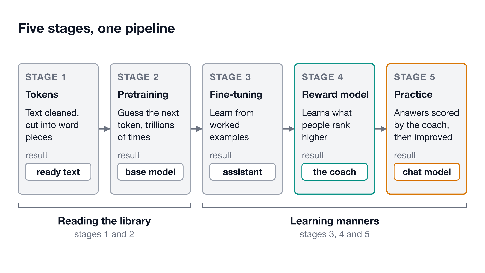
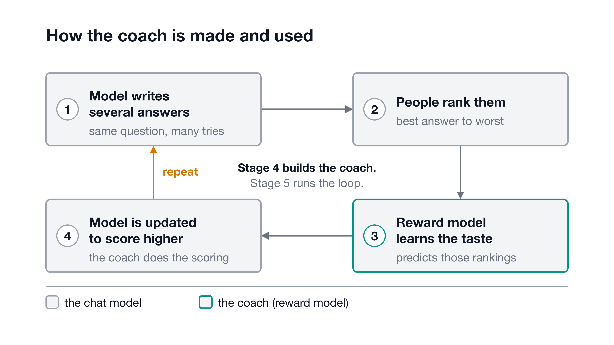
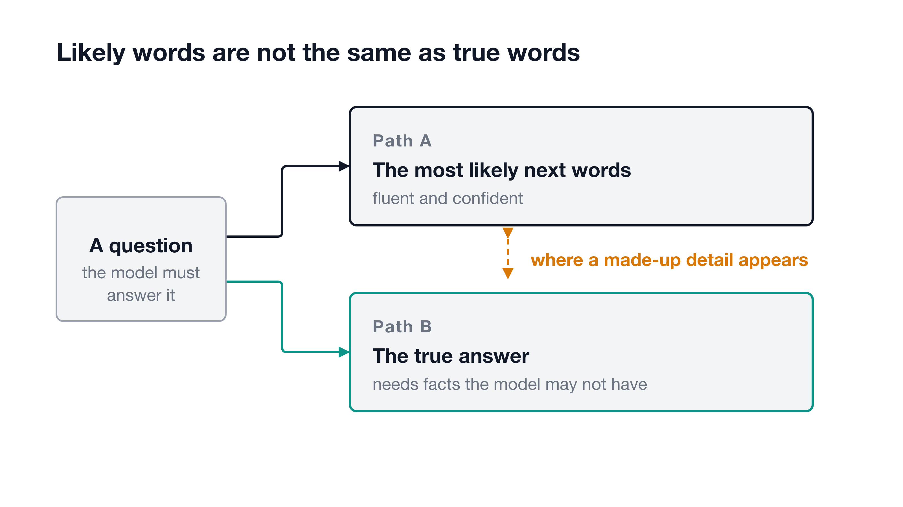

# How a Chat Model Is Made

**Five stages, in plain English, from a mountain of text to an assistant that answers you.**

   
  ▶ <a href="video/how-a-chat-model-is-made.mp4">Watch the explainer video (MP4)</a> · <a href="video/how-a-chat-model-is-made.srt">captions</a>

You type a question and get an answer in your language and your tone. Nobody typed that answer in. It came out of five stages that turned a mountain of text into something that can hold a conversation. After this page you can explain all five to someone else.

## The one idea

> A chat model is a student who read the whole library before learning any manners.

Reading the library is pretraining. Learning manners is the rest: worked examples, a coach who ranks answers, and practice against that coach.

The student is not clever because someone taught it rules. It is capable because it read an enormous amount, and it is polite because later stages shaped how it uses what it read. Keep the two apart in your head and most of the strange behavior of chat models starts to make sense.

<picture>
  <source media="(prefers-color-scheme: dark)" srcset="diagrams/five-stages-dark.png">
  
</picture>

*Five stages, one pipeline: each box feeds the next, and only the last one gives you a chat model.*

## Stage 1: Turn text into tokens

Every model starts with text. Web pages, books, papers, code. Collecting it is the easy half. The hard half is cleaning it.

Raw text is full of junk. Repeated passages get removed, because a model that sees the same paragraph thousands of times learns a skewed picture. Spam, low-quality writing and harmful material get filtered out. The post argues that a model trained on cleaner text usually beats one trained on more, messier text. Quality over sheer volume.

Then the text is cut into tokens. A token is a small word piece, sometimes a whole word, often just part of one. After this step the model never sees letters. It sees numbers that stand for tokens. The post points out that this is one reason chat models can stumble when asked to count the letters in a word.

Nothing has been learned yet. You have only laid out the ingredients: a large, clean, tokenized pile of text, ready to read.

## Stage 2: Guess the next word, a trillion times

This is the read the whole library part, and it is called pretraining. Look back at the diagram: it is the second box.

The job is tiny. Show the model some tokens, hide the next one, and ask it to guess. Compare the guess to the real token. Nudge the model's internal settings, the numbers where it keeps what it has learned, so the guess would have been a little better. Repeat. The post says this runs across trillions of tokens.

That is the whole objective, yet a lot comes out of it. To guess well across books, code and arguments, the model has to absorb grammar, facts and the shape of reasoning. Nobody teaches it these directly. The authors of the InstructGPT paper (2022) describe the usual goal as "predicting the next token on a webpage from the internet." They note it is not the same as following instructions helpfully and safely.

What you get is a base model: brilliant autocomplete, not an assistant. Ask it a question and it may carry on your sentence, or write more questions. The student has read everything and has no idea it is supposed to answer you.

## Stage 3: Show it how to behave

Now the manners begin. The base model is trained further on worked examples: each one pairs a prompt with a good response, such as a question and a useful reply, or a task and its correct result. The formal name is supervised fine-tuning, meaning tuning with examples that show the right answer.

The learning game does not change. The model still predicts the next token. What changes is the material: carefully written demonstrations instead of raw internet text.

The post says this takes thousands to tens of thousands of curated examples, many written or reviewed by people, and that quality beats quantity here too. That is tiny next to the pretraining pile. It is enough because the knowledge is already there. The examples teach the shape of being helpful: when someone asks, answer, and stay on the point.

After this stage the model can follow instructions and is already useful. It is still rough. Judgment and polish come next.

## Stage 4: Teach a coach what "better" means

Many questions have no single correct answer. There are only answers people like more than others. You cannot write a rulebook for that.

So the model writes several answers to the same prompt, and people rank them from best to worst. Then comes the clever move. Those rankings train a second, separate model, the reward model. Its only job is to predict which answer a person would prefer.

Why bother? People cannot read every answer a model produces. A trained reward model can score millions of them, a stand-in for human taste. Think of it as a coach who watched people judge many answers and can now judge on their own. It never talks to users. It works behind the scenes.

<picture>
  <source media="(prefers-color-scheme: dark)" srcset="diagrams/reward-loop-dark.png">
  
</picture>

*The loop in one picture: the model writes, people rank, the coach learns, the model improves.*

## Stage 5: Practice against the coach

Now the student practices. The model writes an answer. The reward model scores it. The model is adjusted so higher-scoring answers become more likely. Then it does it again.

Generate, score, update, repeat. This trial-and-error method is reinforcement learning, and with human rankings behind the coach it is called reinforcement learning from human feedback, or RLHF. Because the coach scores automatically, practice can continue long after people stop writing examples. The post credits this stage for much of a chat model's judgment, consistency and safety, including refusing unsafe requests.

One gloss on a newer variation. Some labs replace part of the human ranking with rankings from a model. The post names this RLAIF, reinforcement learning from AI feedback, where a model's rankings stand in for some of the human ones, guided by a written set of principles the post calls Constitutional AI. The coach changes. The loop does not.

## Why it sometimes makes things up

Go back to Stage 2. The model was optimized to produce likely text, not true text. That is the post's framing, and it explains both the fluency and the failures.

When the model has the facts, likely and true often line up. When it lacks them, it does not stop. It still produces the words that would plausibly come next, in the same confident voice. That is where a made-up detail appears.

<picture>
  <source media="(prefers-color-scheme: dark)" srcset="diagrams/likely-vs-true-dark.png">
  
</picture>

*One question, two paths: the gap between them is where a made-up detail appears.*

Fluency is not evidence. A smooth, sure-sounding answer tells you about the writing, not about the facts. For anything that matters, check it somewhere else.

## What to remember

- Stage 1: clean the text and cut it into tokens.
- Stage 2: pretrain by guessing the next token, which gives a base model.
- Stage 3: fine-tune on worked examples so it learns to help.
- Stage 4: train a reward model on human rankings.
- Stage 5: practice against that coach, over and over.

The post's own advice is to choose stage 1 and build a small version yourself, because the goal is understanding, not rebuilding a frontier model at home. This article adds a suggestion of its own, not the post's: the realistic hands-on step is a tiny stage-2 model of your own.

## In the words engineers use

| Plain words in this article | What engineers say | One line |
|---|---|---|
| Reading the library | Pretraining | Learn by predicting the next token |
| Word pieces | Tokens, tokenization | The units the model actually reads |
| Brilliant autocomplete | Base model | Pretrained, not yet an assistant |
| Internal settings | Parameters | The numbers that store what was learned |
| Worked examples | Supervised fine-tuning (SFT) | Train on prompt and good response pairs |
| The coach | Reward model | Scores answers the way people ranked them |
| Practice against the coach | RLHF | Reinforcement learning from human feedback |
| Principles-guided ranking | RLAIF, Constitutional AI | AI-written feedback guided by written rules |
| A made-up detail | Hallucination | Fluent text that is not true |

## Go deeper

- [nanoGPT](https://github.com/karpathy/nanoGPT): a small, fast repository for training and fine-tuning medium-sized GPT models, pretraining only. Its README now calls it deprecated and points to nanochat.
- [nanochat](https://github.com/karpathy/nanochat): a newer repo with scripts from tokenizer to chat practice.
- [TRL](https://github.com/huggingface/trl): a library for post-training, the work after pretraining: supervised fine-tuning, reward models and online reinforcement learning.
- [Illustrating RLHF](https://huggingface.co/blog/rlhf): a gentle walkthrough of the reward-model recipe.
- [InstructGPT paper](https://arxiv.org/abs/2203.02155): the 2022 paper behind stages 3 to 5.
- [Constitutional AI paper](https://arxiv.org/abs/2212.08073): the principle-guided feedback idea.

## Sources

- Rahul Kumar (@RahulTechX), X, 11:47 PM · Jul 5, 2026, https://x.com/RahulTechX/status/2073977106447634474
- Training language models to follow instructions with human feedback, arXiv, retrieved 2026-10-16, https://arxiv.org/abs/2203.02155
- Constitutional AI: Harmlessness from AI Feedback, arXiv, retrieved 2026-10-16, https://arxiv.org/abs/2212.08073
- karpathy/nanoGPT, GitHub, retrieved 2026-10-16, https://github.com/karpathy/nanoGPT
- karpathy/nanochat, GitHub, retrieved 2026-10-16, https://github.com/karpathy/nanochat
- huggingface/trl, GitHub, retrieved 2026-10-16, https://github.com/huggingface/trl
- Illustrating Reinforcement Learning from Human Feedback (RLHF), Hugging Face blog, retrieved 2026-10-16, https://huggingface.co/blog/rlhf

*Written by Wilson Wu with Claude. The diagrams and the explainer video were generated from the same brief as this article; the video is rendered frame by frame from a small program in `video/`.*
